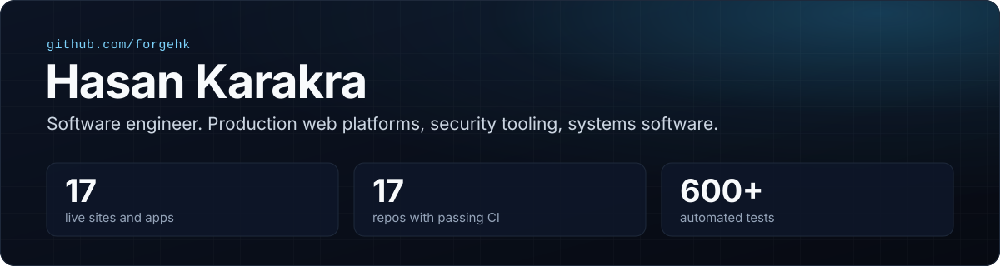

<p align="center">
  <a href="https://hkforge.dev"></a>
</p>

<p align="center">
  <a href="https://hkforge.dev"></a>
  <a href="mailto:info@darkforgeai.com"></a>
</p>

I build the software a business runs on, then the security and systems tooling underneath it. Computer science at CSULB, founder of [DarkForge AI](https://darkforgeai.com), and the developer for a six location pharmacy group in California.

Everything on this page is in production, has a live demo you can open, or ships with a test suite and passing CI. Case studies with screenshots are on [hkforge.dev](https://hkforge.dev).

### In production

| Site | What it does | Built with |
|---|---|---|
| [FarmaciaRx](https://farmaciarx.com) | Group site for six California pharmacies: store directory, prescription transfer and refill request forms, a compounding explainer, and a full Spanish mirror with hreflang. | HTML, CSS, JS, Netlify Forms |
| [FarmaciaRx Care](https://farmaciarxcare.com) | Telehealth front door for the same group: intake, review by a California licensed prescriber, then shipping or pharmacy pickup. There is no cart and no way to order past a prescriber. English and Spanish. | HTML, CSS, JS, Netlify |
| [Farmacia Dinuba](https://farmaciadinuba.com) | Bilingual site for the group's Central Valley store: real store photography, a video tour, a prescription bottle you can drag to turn, and a three step transfer flow. Takes no health details through the site, by design. | HTML, CSS, JS, Canvas |
| [Farmacia Anaheim](https://farmaciaanaheim.com) | The Anaheim store's site, rebuilt as a custom WordPress theme and moved onto hosting I manage: refill, new patient and contact forms that land in the pharmacist's inbox. | WordPress, PHP |
| [Farmacia Wellness](https://farmaciasupplements.com) | Bilingual supplement store for the group: cart and checkout, bundles, wholesale and in store pickup. | HTML, CSS, JS, Netlify, Authorize.Net |
| [HairRx Lab](https://hairrxlab.com) | Telehealth storefront for a compounded prescription, with a scroll pinned sequence and a before and after slider. | Next.js 14, Framer Motion, Lenis |
| [Kormiia](https://kormiia.com) | Telehealth site for a compounded prescription: pricing, safety information and a consultation before any order. California only. | Static site, Netlify |
| [KeyKarams](https://keykarams.com) | D2C product page with a three.js product viewer and a custom cart that hands off to Shopify checkout. | three.js, Shopify, Klaviyo |

### Products

| Product | What it is | Built with |
|---|---|---|
| [Dusklayer](https://dusklayer.com) | A library of cinematic web pages sold as prompts. Pick a scene, section or product film, choose a look, and paste its prompt into Claude Code, Cursor or v0 to rebuild it in your own stack. 22 layers with nine looks each, live previews, accounts and three plans. | TypeScript, Netlify |
| [Sentinel Vision](https://github.com/forgehk/sentinel-vision) | Camera analytics that turns footage into timestamped statuses: desk presence, zone dwell and occupancy, front door alerts, head turn flags in an exam hall. YOLO26 detection and pose models exported to ONNX, running in the browser on WebAssembly or as four Windows apps. Counts people and never identifies them. [Windows release](https://github.com/forgehk/sentinel-vision/releases/latest). | Python, ONNX Runtime, JavaScript, three.js. 41 rule tests, release CI |
| [Nyko](https://nyko.app) | Private AI assistant PWA: chat, vision and PDFs, voice, custom bots, memory, live canvas. | Vanilla JS modules, service worker |
| [CyberForge](https://cyberforge-cecs491a.netlify.app) | Adaptive web security training platform: a 32 question placement, a prerequisite skill graph through 16 lessons and a capstone, labs graded on the server, a nine tool security toolkit. CSULB senior project, team of five, in progress. | Python engine, vanilla JS, Netlify Functions running Pyodide, Supabase, Three.js |

### Security

| Repo | What it is | Status |
|---|---|---|
| [darkforge-edr](https://github.com/forgehk/darkforge-edr) | Linux endpoint detection agent in Go: /proc telemetry through a YAML rule engine, JSON lines alerts with MITRE tags. Evicts exited PIDs so PID reuse is re evaluated. | 47 tests, race detector CI |
| [honeytoken-sentinel](https://github.com/forgehk/honeytoken-sentinel) | Mint decoy AWS, GitHub and Stripe credentials and canary URLs; get alerted the moment one is touched. Unknown token ids answer exactly like real ones, so tokens cannot be enumerated. Stdlib only. | 19 tests |
| [pipeline-armor](https://github.com/forgehk/pipeline-armor) | CI security gate for GitHub Actions: regex secret scanner with an entropy floor, AST pattern scanner, YAML policy engine. Its own CI fails if the gate ever stops blocking the bundled vulnerable demo. | 19 tests |
| [secret-rotator](https://github.com/forgehk/secret-rotator) | Rotate API keys across providers in six steps: snapshot, provision, update the store, verify, grace period, revoke. Any failure rolls back from the snapshot, and every step lands in a tamper evident audit log. | 14 tests |
| [dns-doctor](https://github.com/forgehk/dns-doctor) | One command audit of a domain's DNS, CAA, TLS, SPF, DKIM, DMARC, MTA-STS and HTTP security headers, with a letter grade per check and a punch list. | 36 tests |
| [nextjs-auth-armor](https://github.com/forgehk/nextjs-auth-armor) | Hardened Next.js 14 starter: Supabase magic link auth, Row Level Security migrations, CSP middleware, honeypot forms. | Typecheck, lint and build CI |
| [phish-forge](https://github.com/forgehk/phish-forge) | Score an .eml for phishing from header, URL and body heuristics, with hand rolled typosquat and homoglyph checks. CLI and FastAPI service. | 30 tests |
| [ctf-toolkit](https://github.com/forgehk/ctf-toolkit) | Stdlib only CTF CLI: encoders, classical ciphers, hash identification and cracking, and small e, common modulus and Wiener RSA attacks written from first principles. | 36 tests |
| [steg-toolkit](https://github.com/forgehk/steg-toolkit) | Image steganography: LSB hide and extract, strings recovery, per channel entropy and LSB plane heatmaps. | 12 tests |
| [darkforge-cli](https://github.com/forgehk/darkforge-cli) | One CLI over the tools above: scan a domain, audit a repo or score an email, with severity grading and JSON reports. | 15 tests |

### Systems and compilers

| Repo | What it is | Status |
|---|---|---|
| [tiny-compiler](https://github.com/forgehk/tiny-compiler) | A Pascal style language that compiles to MIPS 32 assembly (SPIM or MARS): lexer, recursive descent parser, AST, codegen and a reference interpreter in about 700 lines of Python. | 41 tests |
| [mips-emulator](https://github.com/forgehk/mips-emulator) | MIPS 32 assembler and single cycle emulator in C++17 with trace and memory dump modes. Runs textbook programs end to end. | 15 tests, CI runs three example programs |
| [cecs327-smart-parking](https://github.com/forgehk/cecs327-smart-parking) | Hand built TCP framing, idempotent request reply, a pub sub broker, registry based group messaging and log replay recovery, from the Python standard library. Team project, CECS 327. | [Live demo](https://cecs327-smart-parking.netlify.app), 35 tests |
| [bigint-cpp](https://github.com/forgehk/bigint-cpp) | Arbitrary precision integers in C++17 with operator overloading, tail recursive factorial and Fibonacci, and a Collatz walker. | 78 checks |

### Tooling

| Repo | What it is | Status |
|---|---|---|
| [lead-foundry](https://github.com/forgehk/lead-foundry) | Normalize, dedupe and ICP score lead CSVs locally, with a pluggable enrichment hook and YAML rules. | 30 tests |
| [pixel-forge](https://github.com/forgehk/pixel-forge) | One product photo to HSV recolored catalog variants with Pillow. Deterministic and offline. | 17 tests |
| [algoviz](https://github.com/forgehk/algoviz) | 3D sorting algorithm visualizer in vanilla Three.js with synced pseudocode. | Browser demo |

### Built for fun, open in a tab

| Demo | What it is | Built with |
|---|---|---|
| [Hyperswarm](https://inquisitive-semifreddo-b68115.netlify.app) | Twin stick roguelite written from scratch in one 182 KB HTML file, with a WebGL bloom pass. | Canvas 2D, WebGL |
| [Universe Drift](https://amazing-flan-f43887.netlify.app) | Real time solar system with free flight, a narrated tour and per planet data. | three.js |
| [Fluid Cursor](https://fluid-cursor-demo.netlify.app) | 4 KB zero dependency spring physics cursor with a data attribute API and a live playground. | JavaScript |

### How I work

```text
Languages   Python · Go · C++ · TypeScript · JavaScript · SQL · Bash
Backend     FastAPI · Node · Netlify Functions · Supabase · SQLite · Pyodide
Frontend    Next.js · React · vanilla JS · Three.js · Canvas · WebGL · WordPress
Commerce    Shopify · Authorize.Net · Klaviyo · bilingual EN/ES storefronts
Vision      YOLO · ONNX Runtime · WebAssembly · OpenCV
Security    YAML rule engines · canary tokens · SAST and secret scanning · CSP and
            security headers · DNS, SPF, DMARC and CAA · threat modeling
Tooling     pytest · Go test · Playwright · GitHub Actions · Docker · Netlify
```

Repositories land here when they pass their tests, not before.

---

<p align="center">
  <a href="https://hkforge.dev">hkforge.dev</a> · <a href="mailto:info@darkforgeai.com">info@darkforgeai.com</a>
</p>
